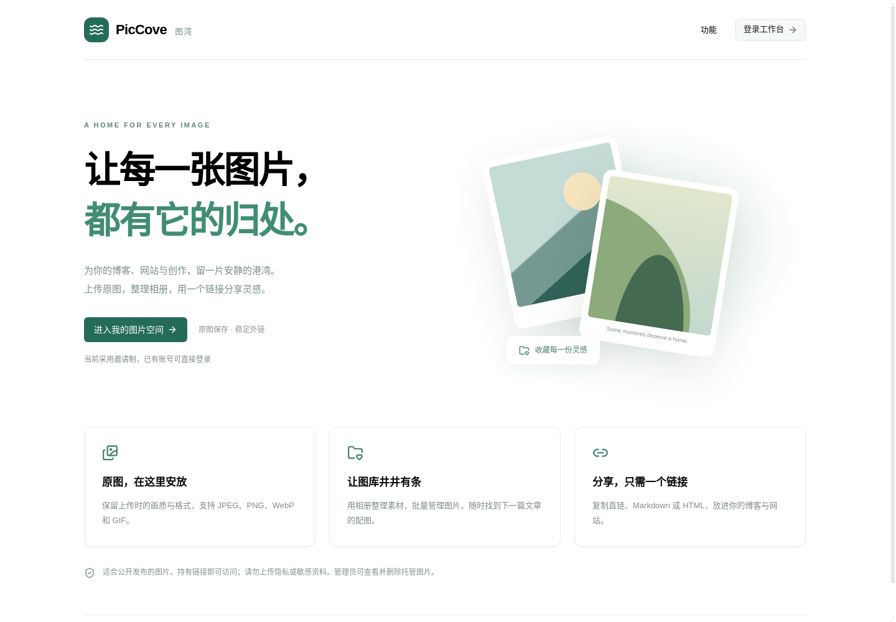
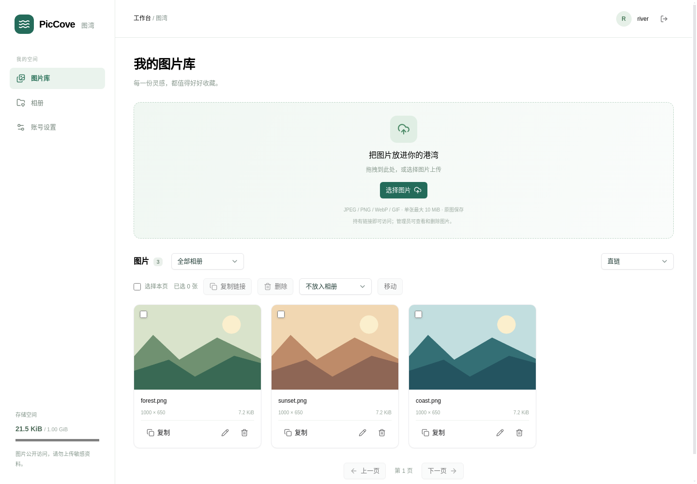
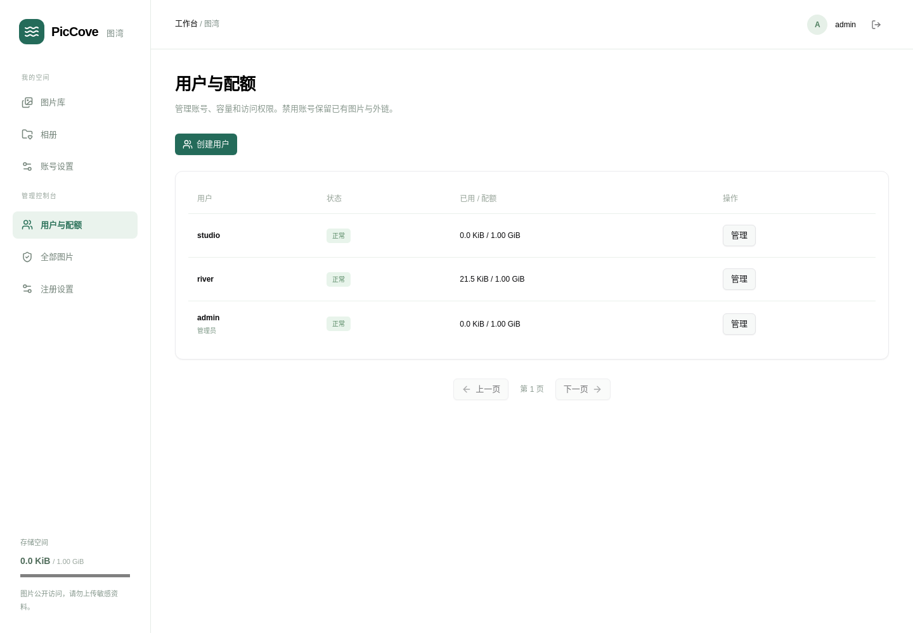

# PicCove · 图湾

**让每一张图片，都有它的归处。**

面向自用和小范围开放的图片托管平台。保存原图、整理相册、复制外链，并由管理员控制注册、用户配额和图片下架。

[安装](#安装与本机试用) · [正式上线](#正式上线) · [使用说明](#使用说明) · [自测](#如何自测) · [构建与发版](#构建与-github-发版)

Android 独立相册首版见 [安卓安装、构建和使用说明](docs/ANDROID.md)。支持手动上传、私有照片、相册整理及确认后公开分享；需要升级到支持私有图片的服务端。

正式域名定为 `tu.jpggg.com`，本机部署状态及具体安装命令见 [域名部署说明](docs/DEPLOY-tu.jpggg.com.md)。

> 当前提供 Linux x86_64 发行流程；仓库为 [dovetaill/PicCove](https://github.com/dovetaill/PicCove)，本轮尚未发布正式 Release。页面截图来自实际运行的 PicCove，图片和账号为演示数据。

## 一键管理

在源码目录运行一个入口，按中文菜单选择安装、打包、发版或运维：

```bash
bash piccove.sh
```

安装默认域名 `https://tu.jpggg.com`、目录 `/opt/piccove`、本机端口 `18081`。本地构建使用普通开发账号；安装和运维使用能访问安装目录与 Docker 的账号。脚本不会自动安装工具或更改系统权限。

服务端发行包统一放在 `release-output/server/v版本/`，Android APK 单独放在 `release-output/android/`。旧的 `android-preview/server` 是联调产物命名，已整理迁出；服务端不属于安卓项目。安装后同一入口位于 `/opt/piccove/piccove.sh`。

[菜单、命令及升级备份说明](docs/OPERATIONS.md)。GitHub 发版会明确确认并推送 main 与 tag；只构建 Linux 服务端和 Web，不构建 Android／Windows PC。

## 页面预览

### 首页



### 用户图片库



### 管理员控制台



## 可以做什么

- JPEG、PNG、WebP、GIF 原图上传，单张最大 10 MiB。
- 相册分类、分页图库、批量移动和删除；复制直链、Markdown、HTML。
- Passkey 优先登录，可切换密码＋验证器动态验证码；个人图库隔离、修改用户名及密码。
- 管理员开启／关闭注册、创建用户、重置密码、禁用账号、调整配额和删除图片。
- 新用户默认 1 GiB 配额，剩余磁盘小于 1 GiB 时暂停上传。

**Web 上传及历史图片默认公开**：持有链接即可访问。安卓新上传默认私有，仅本人及管理员可查看；确认公开分享后访客才可访问。不要上传不希望服务器管理员查看的资料。删除图片不可恢复；删除相册保留图片；修改展示名或移动相册不改变外链。

## 安装与本机试用

### 环境要求

| 用途 | 要求 |
| --- | --- |
| 安装发行包 | Linux x86_64、Docker Engine、Docker Compose v2（支持 `--wait`）、Python 3.11+ |
| 本地源码构建 | 以上环境，加 Rust 1.96.0、Node.js 22+、npm、musl 工具链 |
| 存储 | 为 PostgreSQL、原图与备份预留磁盘；API 的上传保护阈值之外还需要图片空间 |

安装发行包**无需在服务器安装 Rust 或 Node.js**。安装脚本会生成配置、构建两个轻量运行镜像并启动 API、网页和 PostgreSQL；不会安装或改写宿主机 Nginx、修改防火墙或申请证书。首次需要访问容器镜像仓库。

### 1. 获取发行包

尚无 Release 时，先按[源码构建](#源码一键构建)生成发行包；不要期待下面的示例链接现在即可下载。

发布后，可从自己的 GitHub Releases 页面下载 `.tar.gz` 和 `SHA256SUMS`，或执行：

```bash
REPO=dovetaill/PicCove
TAG=v0.1.0                     # 替换为已经发布的版本
curl -fLO "https://github.com/$REPO/releases/download/$TAG/piccove-$TAG-linux-x86_64.tar.gz"
curl -fLO "https://github.com/$REPO/releases/download/$TAG/SHA256SUMS"
sha256sum -c SHA256SUMS
tar -xzf "piccove-$TAG-linux-x86_64.tar.gz"
cd "piccove-$TAG-linux-x86_64"
```

### 2. 启动本机试用

以下操作只在你明确选定的新安装目录执行：

```bash
bash install.sh --origin http://127.0.0.1:8080
```

浏览器打开 `http://127.0.0.1:8080`，用户名 `admin`。使用本地编辑器打开新生成的 `.env`，读取 `PICCOVE_ADMIN_PASSWORD` 初始密码；不要把 `.env` 提交到 Git 或发送给别人。安装脚本不在日志中打印密码。

首次成功登录后，在「账号设置」修改密码；然后清空 `.env` 中的 `PICCOVE_ADMIN_PASSWORD` 值，执行 `docker compose up -d`。已有管理员不会因重启或更改初始化环境变量而被重置密码。

安装失败时先看 `docker compose logs --tail=100`；保留原 `.env`，修正环境问题后执行 `bash install.sh --resume`，不会重新生成数据库密码。

服务仅绑定服务器的 `127.0.0.1`。如果在远程 VPS 上试用，通过 SSH 隧道访问：

```bash
ssh -L 8080:127.0.0.1:8080 your-user@your-server
```

保持该 SSH 会话，在自己电脑打开 `http://127.0.0.1:8080`。需要多个独立安装时，分别指定不同目录、`--project` 和 `--port`，Origin 的端口也必须对应。

## 正式上线

1. 将实际域名解析到服务器，在你现有的站点管理方式中配置有效 HTTPS。
2. 在新的发行包目录运行安装脚本，填写真实域名与联系入口：

   ```bash
   bash install.sh --origin https://img.example.com --port 8080 --contact mailto:admin@example.com
   ```

3. 在**该域名已有的 HTTPS server 块**中，把流量反向代理到安装时的本机端口。例如：

   ```nginx
   client_max_body_size 11m;
   location / {
       proxy_pass http://127.0.0.1:8080;
       proxy_set_header Host $host;
       proxy_set_header Origin $http_origin;
   }
   ```

   这是需要合入现有站点的片段，不是可覆盖整份生产配置的文件。证书、监听地址和其他站点保持由原部署方式管理；不要直接以 root 运行未经隔离的 Nginx 测试配置。

4. 打开域名完成下方人工自测，再配置独立服务器备份。确定管理员联系方式、模板使用授权及项目命名后，再邀请用户。

`PICCOVE_ORIGIN` 必须精确匹配浏览器地址：协议、主机和非默认端口一致，不带路径或末尾 `/`。HTTPS Origin 会启用 Secure Cookie。安装端不会公开数据库或 API 端口，图片与接口通过同一个网站访问。

当前限流采用实际连接来源 IP；反向代理后的用户共享登录／注册 IP 限额，适合当前小范围试用。大量公开注册前需要另行完成可信代理识别和防滥用方案。

## 使用说明

### 普通用户

1. 登录 `/login`；管理员开放注册后，首页才显示注册入口。
2. 在「图片库」选择多张图片或拖入上传区；选择相册后上传，会将新图片放入该相册。
3. 选择「直链」「Markdown」或「HTML」，点击图片上的复制按钮。复制需要 HTTPS，或浏览器认可的 localhost 环境。
4. 在「相册」创建分类，回到图库勾选图片并批量移动；点击编辑按钮修改名称和相册。
5. 删除前核对弹窗提示。删除图片会使服务端外链失效，但不能撤回别人已经下载的副本。
6. 在「账号设置」修改用户名（包括默认 `admin`）、密码，或绑定验证器与 Passkey。修改密码后所有设备需重新登录；修改其他安全设置会退出其他设备。忘记密码请联系管理员。

Passkey 绑定需要 HTTPS（本机 localhost 除外），使用当前网站域名验证；迁移域名后需要重新绑定。登录页默认提供 Passkey，也可选择「改用密码＋二步验证」。未开启二步验证时仍使用密码登录；开启后必须提供六位动态验证码，同一验证码不能重复使用。绑定时请将验证器密钥妥善保存到密码管理器以便恢复；当前没有独立的一次性恢复码。安全设置修改需要当前密码及已启用的验证码，管理员重置密码不会解除二步验证。旧版安卓客户端不支持验证码，需要升级到包含验证码输入框的版本。

安全数据迁移为 `0004_account_security.sql`。启用二步验证后不要回退到不校验验证码的旧服务端。

### 管理员

- **用户与配额**：创建账号，调整容量、禁用用户或重置密码。降低配额不删除已有图片，只阻止超额上传。
- **全部图片**：查看和删除用户托管的图片。
- **注册设置**：默认关闭注册，开启后普通用户可自行注册；关闭不影响已有账号使用。
- 禁用账号会撤销登录、阻止上传，但保留图片外链。需要下架图片时请单独删除。

## 如何自测

### 上线前手工验收

使用管理员和新建的普通账号，分别在两个浏览器会话中操作：

- [ ] 默认没有注册入口；开启后能够注册；关闭后直接访问 `/register` 也不能提交注册。
- [ ] 上传 JPEG、PNG、WebP、GIF；超过 10 MiB 的图片被拒绝。
- [ ] 图片实际显示，点击原图可完整下载；使用一张数 MB 的图片比较下载文件与原文件校验值。
- [ ] 三种复制格式均可使用；在另一浏览器直接打开图片外链。
- [ ] 创建相册、批量移动、改名、删除相册；改名与移动不改变外链，删除相册保留图片。
- [ ] 普通账号看不到他人图库，不能进入管理员页面。
- [ ] 降低配额会阻止新上传；禁用账号使其退出登录，但原外链仍正常；恢复账号及重置密码可生效。
- [ ] 删除测试图片后原链接返回 404，容量相应释放。
- [ ] 改密与退出登录后，旧会话不能继续访问工作台。
- [ ] 在实际手机／桌面浏览器检查按钮、弹窗、文件选择和横竖屏显示。

完成后删除本次测试图片和相册；临时账号可禁用。不要用真实用户图片测试删除功能。

### 自动隔离自测

源码仓库中提供发行包自测脚本，**它不会检查或修改正在运行的站点**，而是创建独立 Compose 项目，测试后删除项目容器、卷及专用镜像：

```bash
# 在源码目录执行；参数必须是尚未安装、没有 .env 的解压发行包。
python3 -B scripts/smoke.py /path/to/piccove-v0.1.0-linux-x86_64
```

该脚本检查真实 Nginx 下的网页及 JS/CSS 完整传输，再执行账号、图片、隔离、配额等 HTTP 功能检查。它不能替代实体设备操作或实际公网 HTTPS 验收。以普通 Docker 用户运行；root 运行时 HTTP 测试子进程会降权，数据库和网页均位于独立容器。

[已有验证记录](docs/VERIFICATION.md)包含 22 项真实 Chromium 交互测试、图片布局复验、备份恢复和旧版迁移验证。

## 日常管理、升级与备份

在安装目录执行：

```bash
docker compose ps                    # 查看状态
docker compose logs --tail=100        # 查看日志
docker compose restart api web       # 重启应用
docker compose down                  # 停止并移除容器，保留数据卷
```

**不要对正式安装执行 `docker compose down -v`**，它会删除数据库和原图卷。`.env` 保存数据库凭据；务必与备份一起妥善保管。

升级前停止应用写入，并同时备份数据库与图片：

```bash
umask 077
BACKUP_DIR="../piccove-backup-$(date +%Y%m%d-%H%M%S)"
mkdir "$BACKUP_DIR"
docker compose stop api web
docker compose exec -T postgres pg_dump -U piccove -d piccove -Fc > "$BACKUP_DIR/database.dump"
docker compose run --rm --no-deps -T --entrypoint tar api -czf - -C /data uploads > "$BACKUP_DIR/images.tar.gz"
cp .env "$BACKUP_DIR/config.env"
```

检查备份命令成功、文件可读，再把备份复制到独立服务器。恢复说明见 [BACKUP.md](docs/BACKUP.md)。上线前自行确定备份位置、保留周期与定期恢复演练；脚本没有自动替你配置异机备份。

升级使用校验通过的新发行包，**在同一安装目录**执行 `tar -xzf /path/to/new-release.tar.gz --strip-components=1`，然后 `docker compose up -d --build --wait`。发行包不含 `.env`，不会覆盖凭据；不要改变原 Compose 项目名，也不要删除数据卷。数据库迁移会在 API 启动时运行；若升级失败，先保留现场，不要未经确认只回退二进制而忽略数据库版本。

## 构建与 GitHub 发版

参考 `vless-chain` 的版本一致性、发行包校验及草稿发布流程，PicCove 使用更小的单平台流程，不复制其代理内核、多系统安装和运维功能。

### 源码一键构建

准备一次构建环境，例如 Debian／Ubuntu 的普通开发账号：

```bash
# 由你在开发机安装构建依赖，脚本不会替你修改系统。
sudo apt-get install -y build-essential musl-tools python3
rustup toolchain install 1.96.0 --profile minimal --component rustfmt --target x86_64-unknown-linux-musl
# 另需已安装 Node.js 22+ 与 npm。
RUSTUP_TOOLCHAIN=1.96.0 bash piccove.sh build
```

脚本检查 Rust 格式、运行单元测试、编译静态 musl API、构建网页并运行前端断言，输出：

```text
release-output/server/v0.1.0/
├── piccove-v0.1.0-linux-x86_64.tar.gz
├── SHA256SUMS
└── release.json
```

构建只使用独占临时工作目录，不覆盖已有 `admin/dist`。结束时删除 target、依赖副本和临时缓存，只保留指定输出中的发行交付物；下一次干净构建会较慢。输出目录已存在时拒绝覆盖。

### 同步版本并创建 tag

```bash
bash piccove.sh version                              # 检查四份清单／锁文件版本
bash piccove.sh version --set 0.1.1   # 下一版示例，首次发布可保留 0.1.0
# 检查差异，按项目规范用中文标题与详细正文提交实际变更。
git add apps/api/Cargo.toml apps/api/Cargo.lock admin/package.json admin/package-lock.json
# git commit：正文记录背景、内容、影响和实际验证，勿省略。
```

先把全部发行源码提交到 `main`，再通过菜单「GitHub 发版」，或执行：

```bash
bash piccove.sh release --yes
```

该命令检查版本一致性、工作区干净及 tag 不存在，然后创建当前版本的附注 tag，原子推送 main 与 tag，由 Actions 构建、验证并发布。它不会自动提交源码或递增版本；重复版本会拒绝，先用「版本」菜单同步新版本并提交。推送失败会保留本地 tag 供核查；不要随意删除或移动已经发布的 tag。

原来的 `scripts/version-release.sh` 仍为底层兼容入口，供现有 CI 调用。

### GitHub Actions 自动流程

GitHub Actions 仅构建 Linux 服务端和 Web；Android 与 Windows PC 客户端不加入 GitHub 构建。

- `main` push / PR：构建、测试并在独立 Compose 项目安装发行包，完成 HTTP 功能自测。
- `v*` tag：校验 tag 与 Cargo/npm 四份版本文件一致，构建发行包并完成自测。
- 验证通过后创建 GitHub Release 草稿，上传压缩包、SHA256SUMS、release.json，再下载逐字节核对，最后公开 Release。
- 已发布版本不覆盖；失败的同提交草稿可通过重新运行该 tag 的 workflow 重试。
- 使用仓库自带 `GITHUB_TOKEN`，发布 job 需要 `contents: write`；不需要额外 PAT，不推送容器仓库，不保留编译缓存。

需要在 GitHub 仓库中启用 Actions。只有真正推送 tag 后才能验证远端 runner、仓库策略和 Release 权限；当前本地验证不代表远端发布已经成功。[GitHub 官方发布命令说明](https://cli.github.com/manual/gh_release_create)。

## 源码目录与开发

`apps/api` 是 Rust API；`admin` 是统一的 React 前台与后台；`deploy` 是发行包部署配置；`scripts` 是构建、安装和隔离自测脚本；`tests` 是定向验证；`docs` 是截图及运维说明。原 `apps/web` 已迁移到 `admin`。

本地调试可在独立数据库中配置 `apps/api/.env.example` 后运行 `cargo run`，另在 `admin` 执行 `npm ci && npm run dev`。不要连接生产数据库或以 root 启动调试服务。完成后停止进程、清理本次 target／临时产物；保留正式安装和原有数据。

## 当前边界

首版为单进程、本地存储的自用／小范围试用版本。支付、对象存储、自动压缩和水印、带密码／到期时间的分享、回收站、迁移中心、SDK、iOS 与桌面客户端暂未实现。Android 首版不含自动备份。尚未验证 ARM64、Windows、macOS 服务端安装及大规模公开注册。购买模板的源码与成品分发须遵守原授权；项目商标与域名尚未完成商业核查。

已存储私有图片后，不能直接回退到不检查图片权限的旧 API，否则可能暴露私有原图。详见 [安卓版本的升级与回退边界](docs/ANDROID.md#服务端先升级)。
