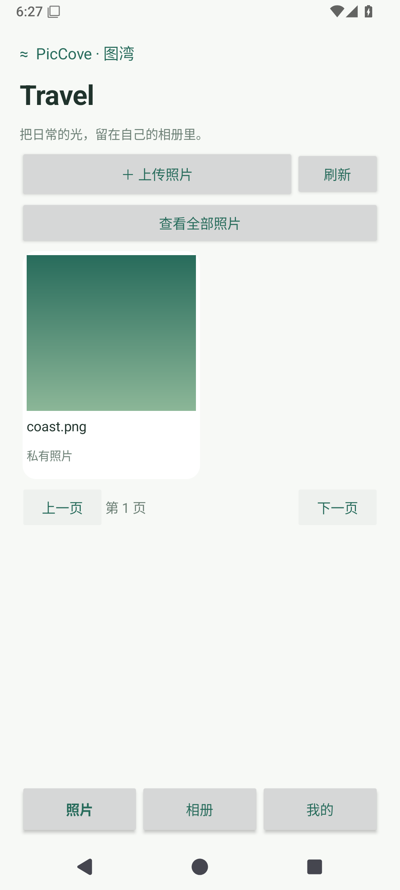

# 图湾 Android 相册

Android 8.0（API 26）及以上的独立原生相册 App，仅开发 Android。客户端位于 `apps/android`，使用 Java、系统界面和系统文件选择器，无 WebView 和第三方运行时依赖。



## 首版功能

- 连接自己的 PicCove HTTPS 站点，使用已有账号登录。
- 两列照片库、分页、图片预览、刷新，以及横屏／大屏三列显示。
- 通过系统选择器手动多选上传 JPEG、PNG、WebP、GIF，每张最大 10 MiB。不申请全盘照片读取权限。
- 新上传照片直接保存为私有；仅本人及服务器管理员可以读取，不是端到端加密。
- 创建／删除相册、相册筛选、移动图片、修改图片名称、删除云端照片。
- 确认后公开并调用 Android 分享面板发送链接；可停止公开分享。已被他人保存的副本无法撤回。
- 查看容量、退出登录。会话仅保存在进程内存，密码不落盘；进程结束后重新登录。

本轮不含自动备份、后台上传、离线图库、视频、HEIC 转码、回收站或 iOS。预览目前下载原图后受限解码，没有服务端缩略图；大图库浏览会消耗较多流量，GIF 首版显示静态首帧。上传时保持 App 前台；被系统终止时未完成项不自动重试，重新打开后先检查云端已保存的照片。

## 服务端先升级

安卓登录前检查 `/api/v1/settings` 返回 `private_images: true`。旧服务器不支持私有图片时拒绝登录，防止静默降级为公开上传。

此版本新增 `0003_private_images.sql` 迁移，API 启动时自动执行。旧图片与 Web 新上传保持公开，历史链接不变。安卓上传使用 `POST /api/v1/images?private=true`，权限在文件保存前写入数据库；`PATCH /api/v1/images/{id}/visibility` 仅允许图片所有者修改。私有图片的原图请求须携带有效会话；陌生人、其他普通用户或已禁用账号不能读取。Web 图库展示私有标记，并阻止复制私有图片的公开链接。

已升级并保存私有图片后，**不可直接回退到不检查 `is_public` 的旧 API 二进制**，否则可能公开私有原图。升级前按备份说明保存数据库与图片；回退应恢复完整升级前备份，并确保期间新私有图片不被旧服务暴露。

## 构建 APK

普通开发账号需要 JDK 17+（包含 javac）、Android SDK Platform 36、Build Tools 35.0.0，并配置 `JAVA_HOME` 和 `ANDROID_HOME`。仓库自带 Gradle 8.13 wrapper 和发行校验值，首次联网下载 Gradle 与构建依赖。

```bash
bash scripts/build-android.sh ./release-output/android-local
```

脚本执行单元测试、Android Lint 和 APK 构建，编译缓存及临时源码完成后删除，仅保留 APK 和 SHA256SUMS。下一次干净构建需要重新下载依赖。也可以用 Android Studio 打开 `apps/android`；IDE 自行生成的缓存由开发者管理。

输出为 **debug 测试签名 APK**，可传到安卓手机安装，不用于正式分发或商店上架。临时构建每次可能生成不同测试签名，升级时可能需卸载旧测试 App；云端照片不受影响，本机登录信息会清除。正式版需要你自己保管的固定签名密钥，仓库不生成或提交商业签名私钥。release 构建强制 HTTPS；debug 仅额外允许 localhost、127.0.0.1、模拟器 10.0.2.2 的 HTTP，普通局域网 HTTP 仍拒绝。

## 使用

1. 升级并启动服务端，通过 HTTPS 站点创建账号或由管理员创建。
2. 手机安装 APK，输入站点 Origin，例如 `https://img.example.com`，不带 `/api` 或其他路径。
3. 登录后点「上传照片」，在系统选择器中选图，等待逐张上传结果。
4. 在「相册」新建相册；打开照片可移入相册、改名、公开分享或永久删除。
5. 分享前核对公开确认提示；停止分享后，未登录访问原链接应返回 404。

不要把服务端初始化管理员密码打包到 App，也不要关闭 HTTPS 证书验证。管理员可查看私有图片；不希望服务运营者访问的资料不适合上传此版本。

## 自测清单

- 正确及错误密码、旧服务器拒绝连接、会话过期后回到登录页。
- 系统多选上传，单张超限和不支持格式有错误提示，部分成功数准确。
- 新照片本人可见，另一普通账号和未登录浏览器不能下载；公开分享后可访问，停止分享后不可访问。
- 相册创建、移动、筛选、删除相册保留照片；云端删图不删除手机原图。
- 手机上检查横竖屏、系统状态栏／导航栏／键盘、分享面板、返回键及网络中断。
- App 退出登录后清空照片显示；杀死 App 重启后重新登录，不自动恢复密码。

开发验证与清理记录见 [VERIFICATION.md](VERIFICATION.md)。模拟器通过不代表实体手机、厂商后台策略或商店审核已验证。

构建配置参考 [Android 官方 AGP 8.13 兼容说明](https://developer.android.com/build/releases/agp-8-13-0-release-notes)，系统文件选择遵循 [Storage Access Framework](https://developer.android.com/training/data-storage/shared/documents-files)。
