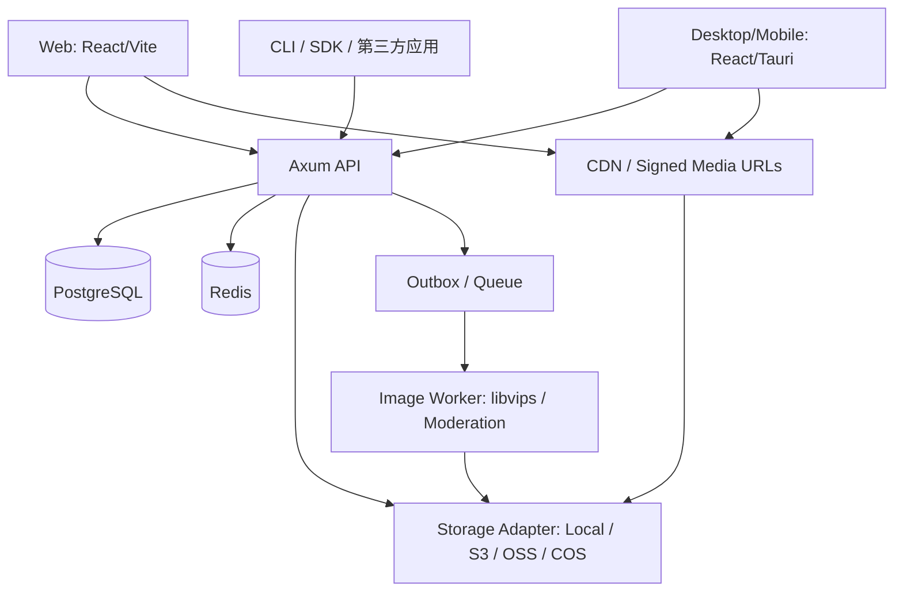

> 历史规划参考：首版以 `README.md` 与 `docs/ROADMAP.md` 的已确认范围为准。本文中的多端、支付、对象存储与模块化等设想不构成当前实现授权。

# PicCove · 商业图床架构设计（Draft v1）

## 1. 产品定义

PicCove（中文名：图湾）= 面向个人、创作者、团队、开发者及企业的**图片托管、管理、分享和图片云处理平台**。计划同时支持：

- SaaS 运营：单部署、多租户、多套餐、在线计费和客服工单。
- 私有部署：独立应用实例、一键 Docker Compose、支持本地盘/S3 兼容对象存储。
- 客户端：Web 首发；Tauri 2 桌面端；Android/iOS；公用 Rust API；另提供 CLI/SDK。

## 2. 推荐技术栈

| 模块 | 主技术 | 说明 |
|---|---|---|
| API | Rust stable + Axum + Tokio | REST API，OpenAPI/Swagger |
| DB | PostgreSQL 16 + SQLx | 强类型查询、事务、迁移 |
| 缓存/任务 | Redis 7；先 DB outbox + worker，规模化用队列 | 上传会话、限流、去重任务 |
| 媒体存储 | 统一 StorageProvider trait | local / S3-compatible 第一阶段；OSS/COS 单独适配第二阶段 |
| 图片变换 | libvips（异步 Worker） | 缩略图、WebP/AVIF、水印、EXIF 清理；隔离处理环境 |
| Web 控制台 | React + TypeScript + Vite | TanStack Query/Router、shadcn/ui、Tailwind、React Hook Form/Zod |
| 桌面/移动 | Tauri 2 + React（逐端适配） | Windows/macOS/Linux/Android/iOS；移动端相册权限等需单独测试 |
| 官网/SEO | Next.js（独立应用，可延后） | 市场宣传、套餐、产品帮助页 |
| 流量分发 | Nginx/Caddy + CDN | 直连对象存储，非 API 服务转发全量图片 |
| 可观察性 | tracing + OpenTelemetry + Prometheus/Grafana | 请求链路、上传速度、账单指标、告警 |

*工程原则：大部分跨端界面使用 React；纯 Rust Dioxus 是替代方案，不把 React 和 Dioxus 混成统一组件运行时。*

## 3. 逻辑架构



建议开始时**单体 API + 独立异步 Worker**，在边界清晰后再拆微服务。通用的用户、租户、套餐、上传会话、存储驱动与图片记录必须由后端统一管理。独立客户端只调用同一套 REST API。

## 4. 核心业务表（商业版）

1. `users` 用户：id、email、password_hash、status、email_verified_at。
2. `organizations` 租户/团队：id、name、owner_user_id、status。
3. `memberships`：organization_id、user_id、role（owner/admin/member/viewer）。
4. `storage_providers`：organization_id、driver、bucket、region、endpoint、encrypted_credentials、status。
5. `upload_policies`：organization_id、provider_id、accepted_types、max_bytes、watermark、naming_rule、moderation_rule。
6. `albums`：organization_id、parent_id、name、visibility。
7. `assets`：organization_id、uploader_id、storage_provider_id、album_id、object_key、sha256、size、mime、width、height、visibility、status、created_at。
8. `asset_variants`：asset_id、recipe_hash、object_key、mime、width、height、size、status。
9. `upload_sessions`：organization_id、asset_id、nonce、provider_id、status、expires_at、reserved_bytes、confirmed_bytes、idempotency_key。
10. `plans`、`subscriptions`、`orders`、`payments`、`usage_ledgers`：套餐、订单与流量/容量账务。
11. `api_keys`、`shares`、`audit_logs`、`reports`、`support_tickets`。

所有租户资源 API 必须根据登录主体的成员关系执行服务端租户授权；前端提交的 `organization_id` 不能单独作为授权依据。

## 5. S3 直传流程（商业版推荐）

1. 客户端向 API 申请 `POST /api/v1/uploads/prepare`，声明文件信息、散列、上传策略。
2. API 鉴权、获取当前租户、执行限流、检查套餐配额并预留空间；创建 `upload_session`。
3. API 基于指定的 StorageProvider 产生**短期受限** PUT/POST 预签名 URL；每个上传会话只能写指定 Key。大文件改 Multipart Upload。
4. 客户端直接上传到对象存储；不会先将整个文件送入 Axum。
5. 客户端调用 `POST /api/v1/uploads/{id}/complete`。API 服务端 `HEAD` 对象并验证长度、元信息、哈希/校验和（校验方式视云服务支持情况）；严禁仅凭前端上报成功写库。
6. 数据库事务内处理会话状态、配额结算及 outbox 事件（保证重复 complete 幂等）；失败上传按超时任务回收/释放预留额。
7. Worker 在隔离环境执行真实格式解析、图片尺寸和像素限制、必要的安全扫描、EXIF/GPS 清理、缩略图生成、格式转码与内容审核；未完成时原图不可公开。
8. 审核/处理通过后资源状态变为 `ready`，返回媒体 URL，按可见性选择公开 CDN 或短期签名访问/应用鉴权网关。

### 要点

- 图片原始 Key 随机化，禁止使用未经处理的用户文件名直接写路径；用户原文件名仅做元数据。
- 白名单 MIME 与魔数验证；解码器必须有限制并置于低权限 Worker，处理不可信 GIF/动画/畸形图片。
- 默认拒绝 SVG/HTML 等带主动脚本能力的格式；如确有业务需求，实施严格清洗与独立域名隔离。
- 存储凭证使用 KMS/加密信封并定期轮换；前端不直接接触长期 Access Key。
- 私有图片不能使用公开 Bucket + 永久 URL；CDN 缓存键、签名过期和删除失效策略需要整体设计。
- 每个图片可采用 original/thumbnail/preview 多种版本；客户端请求变换不可以接收任意尺寸或任意表达式，以防滥用 CPU。
- 按**存储占用 + CDN 出站流量 + 图片处理量**核算成本与套餐，周期性账单对账，不以请求次数代替真实带宽。
- 版权/违规投诉、审核日志、内容删除、保留策略、禁止盗链和防刷都属于商业上线门槛。

## 6. 跨端共用结构

```text
apps/
  web/               React + Vite：登录、上传、图库、后台
  marketing/         Next.js：官网、SEO、文档（后续）
  desktop/           Tauri 2：桌面外壳，复用 web UI（后续）
  mobile/            Tauri 2：移动端体验和相册接入（后续）
  api/               Rust Axum API
  worker/            Rust 图片处理/审核 Worker
crates/
  domain/            实体、业务规则
  storage/           StorageProvider trait 与各家驱动
  media/             格式验证与转换任务定义
  billing/           套餐、余额、配额、幂等计费
  auth/              鉴权和 RBAC
packages/
  ui/                React 组件（Web / Tauri 可复用）
  api-client/        OpenAPI 生成 TypeScript SDK
  config/            前端共享配置
infra/
  compose.yml
  nginx/
  migrations/
```

目前仓库包含上述设计中最小的 `apps/api` 与 `apps/web` 和开发用 `infra/compose.yml`。请不要将设计中未实现模块理解为已经开发完成。

## 7. 端点（商业版规划）

```text
POST   /api/v1/auth/login
POST   /api/v1/auth/refresh
GET    /api/v1/me
GET    /api/v1/organizations
POST   /api/v1/uploads/prepare
POST   /api/v1/uploads/{id}/complete
DELETE /api/v1/uploads/{id}
GET    /api/v1/assets?cursor=...
GET    /api/v1/assets/{id}
PATCH  /api/v1/assets/{id}
DELETE /api/v1/assets/{id}
POST   /api/v1/albums
GET    /api/v1/storage/providers
POST   /api/v1/storage/providers
POST   /api/v1/storage/providers/{id}/test
GET    /api/v1/billing/usage
POST   /api/v1/billing/orders
POST   /api/v1/shares
```

提供 OpenAPI 3.1 文档与自动生成 SDK。需要维护稳定语义版本与弃用策略。

## 8. 商业产品定位

- **社区版**：个人部署，本地/S3、用户、图库、图片直链、基础水印和开发者 API。
- **Pro**：多存储策略、批量上传、自动变换、复杂授权、按资源治理和流量分析。
- **Business**：多组织、品牌域名、细粒度 RBAC、审计、工单/付费套餐、SSO、外部审核服务。

可选择订阅托管 SaaS、商业许可证或二者并行，计费务必考虑带宽和存储真实成本。

## 9. 命名

- 主推：**PicCove · 图湾**。`Cove` 意为港湾，寓意图片可以可靠托管、统一管理和分享。
- 备选：**PixNest · 像巢**、**FrameDock · 影坞**、**ImgPort · 图港**。

这些都是策划提案，**未经完整商标/域名检索**；正式商业使用前务必核查。
