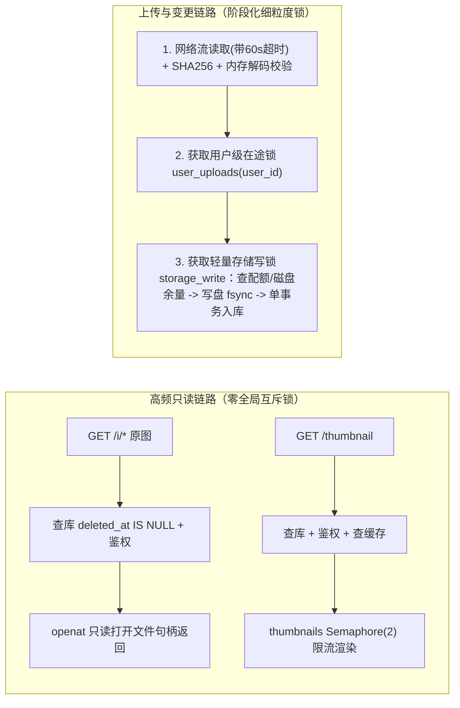

# 02 · 技术方案与架构设计（最小完整改动 · 单一事实源）

本文档针对《01 · 原因分析》确认的全部问题与演进需求，给出可直接落地的技术设计方案。所有设计严格遵守四条工程铁律：
1. **最小完整改动**：基于现有 Rust + Axum + PostgreSQL + React 单体架构演进，不引入 Redis、消息队列或多余抽象层。
2. **单一事实源**：限流识别、软删除过滤口径、图片分享判定、运维操作面板只保留唯一权威实现。
3. **严禁静默吞错与猜测性兜底**：基础设施故障返回明确 `5xx` 或保留可重试现场，绝不伪造空数据或吞掉状态回写错误。
4. **100% 尊重现有合法契约**：保留历史 `/i/{uuid}` 与日期外链、保留 `?ids=` 对账语义、保留本站 `in.mb.al` 容器网关 AI 路由。

---

## 一、安全、并发与运维可靠性加固方案

### 1. 解耦 `state.uploads` 大锁：读写分离 + 按用户对账锁 + 短临界区写锁

- **核心设计**：
  1. **原图与缩略图彻底脱离 `state.uploads`**：
     - 现有写入顺序保证文件在 `deleted_at` 置为 `NULL` 前已完成 `write_new + sync_all`；迁移顺序保证目标盘 `copy_verified` 校验通过后才切换 `storage_root`，清理任务只删非当前 `storage_root` 的旧盘副本。
     - 因此 `serve_image` 与 `thumbnails::serve` **完全无需持有全局写锁**！若读取瞬间恰好撞上并发删除导致底层 `ENOENT (NotFound)`，直接映射为标准 `404 missing()` 即可。
  2. **网络读取与图片解码移出锁外**：
     - `upload_image` 先用 `tokio::time::timeout(Duration::from_secs(60), ...)` 完成 multipart 字段读取、计算一次 `Sha256` 摘要（消除原先重复算 3 次哈希的浪费）并在 `spawn_blocking` 中完成 `validate_image` 解码。慢速客户端再也无法占锁阻塞他人。
  3. **保留同账号断连对账契约**：
     - 引入轻量的按用户锁表（如 `Mutex<HashMap<Uuid, Arc<Mutex<()>>>>`，用完即清或弱引用回收）：用户上传进入正式请求后持有本账号在途锁，同账号的 `GET /api/v1/images?content_hash=...` 对账请求仅等待该用户自己的在途锁（最长 10 秒返回 `503`），既 100% 兼容 `tests/albums_http.py:139` 的断连恢复契约，又彻底杜绝跨用户阻塞。
  4. **消除上传写盘失败的幽灵记录**：
     - 调整 `store_image`：先在目标存储目录用 `write_new` 写入原图文件并 `sync_all`（若写盘报错，直接清理该新文件并返回错误，不污染数据库）；或者在数据库预插入失败后的 `Err` 分支立即同步清理该临时行，确保写盘失败不会留下占用配额和触发无效审核的残留记录。

### 2. 可信反代真实 IP 识别 + 用户名级防爆破双层限流
- **拓扑与配置修复**：
  1. `deploy/nginx.conf`（容器内 Nginx）：在 `location /api/` 增加传递上游连接信息；当宿主机反代位于前侧时，宿主机 Nginx 设置 `proxy_set_header X-Real-IP $remote_addr;`，`deploy/nginx.conf` 透传 `proxy_set_header X-Real-IP $http_x_real_ip;`（若宿主机未传则回退 `$remote_addr`）。
  2. `apps/api` 新增单一事实源函数 `client_ip(headers, peer, trust_proxy)`：
     - 仅当 `peer.ip()` 为回环地址或容器内网网段（可通过环境变量 `PICCOVE_TRUST_PROXY=true` 控制，`deploy/compose.yml` 默认开启，本地裸跑默认关闭防伪造）且 `X-Real-IP` 为合法 `IpAddr` 时采用该 IP，否则使用 `peer.ip()`。
- **限流策略精细化**：
  1. **先做零成本格式校验，再扣限流配额**：`validate_credentials`（纯内存长度与 ASCII 检查）移到 `rate()` 之前，避免畸形短请求白白消耗限流桶。
  2. **登录限流改为“客户端 IP + 目标用户名失败计数 + 全局保护”**：
     - `login:ip:{ip}`：20 次/分钟（防单 IP 扫描多账号）；
     - `login:user:{username_lower}`：**仅在密码或 TOTP 验证失败时累加**（如 10 次失败/5 分钟），防止攻击者轮换代理 IP 针对 `admin` 暴力撞库，同时保证正常用户输入正确密码不受他人针对其它账号的攻击牵连；
     - Passkey `login_start` 使用独立键 `passkey-start:ip:{ip}`，不再挤占密码登录桶。
  3. **降低 `rate_limits` 写放大**：过期记录清理改为按概率/时间间隔（如每 60 秒最多执行一次异步清理）或仅覆盖当前冲突过期键（`ON CONFLICT(key) DO UPDATE SET hits = CASE WHEN rate_limits.expires_at < NOW() THEN 1 ELSE rate_limits.hits + 1 END, expires_at = CASE WHEN rate_limits.expires_at < NOW() THEN NOW() + ... ELSE rate_limits.expires_at END`——**这同时修复了原先固定窗口一旦命中冲突永不重置 `expires_at` 的隐蔽逻辑问题！**）。

### 3. 启动自愈、`piccovectl backup` 与 `update` 状态机加固
1. **`bootstrap` 故障隔离（`main.rs:1343`）**：
   - 启动遍历 `deleted_at IS NOT NULL` 时，单条记录清理失败仅记录结构化 `tracing::warn!(image_id, storage_root, error)` 并保留该待清理行供后续重试，**绝不因次要存储盘离线而阻断主服务绑定端口启动**（主默认盘 `UPLOAD_DIR` 启动身份校验保持严格阻断不变）。
2. **`piccovectl backup` 闭环加固（`ctl/mod.rs:1064`）**：
   - 先获取运维锁并停止 `api`/`web` 写入，**在停写状态下**执行外部存储目录核查（保证快照绝对一致）；
   - 将可选存在的 `compose.override.yml` 一并纳入备份归档与 `SHA256SUMS` 校验清单；
   - 将“清理临时备份容器”与“恢复启动原运行服务”解耦为独立恢复块：无论归档还是删临时容器是否报错，都确保执行 `compose up -d --wait`（或 `start` + `health`）恢复原线上服务，并汇总输出全部错误。
3. **`piccovectl update` 零误伤两阶段状态机（`ctl/mod.rs:935`）**：
   - **压缩停机窗口**：在停止线上容器前，先在独立构建目录基于新包完成 `Builder::build` 镜像预构建（下载编译期间线上网站正常服务），构建成功后再 `stop api web` -> 替换文件 -> `up -d --wait` -> `health()`（增加 `/api/v1/settings` 数据库连通探针验证）。
   - **验收切换与旧资源清理解耦**：一旦新服务通过 `health()` 且 `release.json` 更新完成，即移除 `.piccove-update-pending.json`（标记升级成功生效！）；随后的旧文件删除与 `prune_images` 若遇到个别镜像被占用或清理失败，仅打印明确告警提示手工清理，**绝不反手停掉已经健康运行的新版生产服务**。
   - **特权目录祖先校验**：在注册 `root` 运行的 `web-manager` 服务及安装升级时，补充校验安装目录及其各级祖先目录均归属 `root` 且非全局/组可写（`mode & 0o022 == 0`），彻底封死自定义路径下的目录劫持风险。

### 4. AI 状态机、权限补齐与 `deleted_at` 口径统一
1. **AI 生图原子提交与可靠失败回写**：
   - `store_image` 落盘后，将“激活图片 `deleted_at = NULL`”与“更新 `ai_messages` 为 `completed` 并绑定 `image_id`”放入**同一个数据库事务**提交；
   - 生成失败回写 `status = 'failed'` 增加有限重试与显式错误日志，若启动恢复时发现孤儿未关联消息则安全兜底，杜绝 `let _ =` 静默吞错导致永久锁死会话；
   - `enqueue_review` 对已处于 `'failed'` 状态的同用户同哈希记录改为 `ON CONFLICT (user_id, content_hash) DO UPDATE SET status = 'pending', attempts = 0, next_attempt = NOW() WHERE image_reviews.status = 'failed'`，允许故障恢复后重传自动重审；
   - 管理员人工裁决 `review_decision` 若未指定新分类则保留原 `categories`，不清空模型识别证据。
2. **权限与错误分类**：
   - `update_visibility` 事务内补齐 `if current.disabled { return Err(unauthorized()); }`；
   - `authorize_image` 区分“无 Cookie / 会话无效（视为匿名）”与“数据库查询异常（返回 `500 internal`）”，不再把数据库故障伪装成 `404`；
   - `update_user` 仅在修改 `disabled = true` 或重置密码时递增 `security_version` 并清会话，单纯调整配额数字不再打断用户正在进行的安全操作。
3. **统一 `deleted_at` 数据口径**：
   - 保留 `GET /api/v1/images?ids=...` 返回含 `deleted_at` 的记录以兼容前端 `latestPictures` 核对；
   - 普通分页图库浏览（`ids IS NULL`）默认增加 `AND deleted_at IS NULL`，与相册计数和 `admin_overview.images_total` 保持 100% 一致；
   - `admin_overview` 与 `storage::list` 统一区分有效图片统计（`WHERE deleted_at IS NULL`），消除界面张数矛盾。

---

## 二、删除、合并与精简方案

1. **发行包 `docs/` 白名单脱敏**：修改 `scripts/release.py`，发行包 `stage/docs/` 仅复制 `OPERATIONS.md`、`BACKUP.md`、`ANDROID.md` 及 `screenshots/`，彻底将 `DEPLOY-tu.jpggg.com.md`、`ui-redesign/`、`system-audit/`、`ARCHITECTURE.md`、`CODEX_PROMPT.md` 排除在公开 Release 产物之外。
2. **合并/移除重复接口与配置**：
   - 移除 `management::storage` 与 `management::set_storage`（`/api/v1/admin/storage`），将 `tests/api_smoke.py` 对应的存储权限与路径边界断言迁移至 `/api/v1/storage-locations`；
   - 删除 `admin/documentation.html`、`admin/nginx.conf`、`apps/web/` 目录、`docs/CODEX_PROMPT.md`，移除 `infra/compose.yml` 中的 `redis` 服务，重写贴合实际的 `admin/README.md`；
   - 从 Git 移除 `artifacts/ui-review/*.png` 并在 `.gitignore` 忽略 `artifacts/`。
3. **前端组件与重复面板瘦身**：
   - 抽离共享组件 `admin/src/features/admin/system-service-card.tsx`，消除 `overview-page.tsx` 与 `settings-page.tsx` 之间 160+ 行重复代码；
   - 清理 `admin/src/components/ui/` 下确认零引用的冗余模板组件及 `admin/public/media/app/` 下未使用的 18 个 Keenthemes 模板图标，提供干净的图湾 SVG 图标作为 `favicon.svg` / `favicon.ico`。

---

## 三、现有功能与性能改进方案

1. **首屏秒开（Nginx Gzip + 路由级按需分包）**：
   - 在 `deploy/nginx.conf` 启用 `gzip on; gzip_min_length 1024; gzip_types text/plain text/css application/json application/javascript image/svg+xml;`；
   - 在 `admin/src/App.tsx` 使用 `React.lazy` + `Suspense` 对 `AiStudioPage`、`AccountPage` 及 5 个 `Admin*Page` 按路由懒加载，移除 `vite.config.ts` 中掩耳盗铃的 `chunkSizeWarningLimit: 3000`；
   - 登录页 `/login` 在非 HTTPS / IP 访问环境下自动默认选中“密码登录”标签页，已登录用户访问 `/login` 自动跳转 `/app`。
2. **图片 HTTP 条件缓存（兼顾即时撤销权限与省流量）**：
   - 对 `serve_image` 和 `thumbnails::serve`：生成基于内容/身份的强 `ETag`（如原图 `"orig-{id}"`、缩略图 `"thumb-{id}"`，因为 PicCove 原图内容不可变），设置 `Cache-Control: private, no-cache`（每次仍向服务端发起轻量请求经过完整权限、公开状态与审核状态检查，通过后若 `If-None-Match` 命中则直接返回零字节 `304 Not Modified`，无需读盘和重传几 MB 原图！）；对敏感安全接口（如 `/me/totp/start`）显式加 `Cache-Control: no-store`。
3. **补齐图片批量写接口 `POST /api/v1/images/batch`**：
   - 支持单次最多 48 个 `ids` 执行三种动作之一：`move`（设置 `album_id`）、`visibility`（设置 `is_public`）、`delete`（管理员或本人批量删除），一次鉴权返回逐项成功/跳过结果，前端告别 48 次串行循环；
   - 同时修复前端删除遇到 `500`/网络异常时误删本地历史的问题，以及 `GalleryPage` 全局 `paste` 事件漏写依赖数组问题，并为 React Query 私有查询键补上 `account.user.id` 命名空间。
4. **上传中心“批次隔离”与历史收敛**：
   - 为每次触发上传分配 `batchId`，“复制本次链接”仅复制最新批次（或未清除的当前会话批次）图片，不再混入陈旧记录；新增“清除已完成项”快捷按钮，并对 IndexedDB 中已完成的纯历史展示记录保留最近 100 条自动淘汰（未完成/待重试项不受限）。
5. **AI 会话管理闭环与 Worker 即时响应**：
   - 新增 `PATCH /api/v1/ai/conversations/{id}`（重命名标题，1~100 字符）与 `DELETE /api/v1/ai/conversations/{id}`：为避免删会话级联清空 `ai_messages` 导致绕过当日生图额度统计，采用轻量 `archived_at TIMESTAMPTZ` 软归档（列表隐藏、禁止继续发消息，当日额度统计不受影响，夜间或超 24 小时后可安全物理清理无用归档记录）；
   - 放宽历史图删除限制：`generate()` 仅要求**实际将要发送给上游的参考图/最近一张基准图**存在且通过审核，不再因为多轮之前某张无关历史图被删而报废整段对话（同时保留对历史明确违规 `blocked/review` 会话的拦截）；
   - 优化 `review_worker` 与 `generation_worker`：队列有待处理项时立即循环领取下一项（直到填满并发槽或队列为空），仅在空闲或出错时 `sleep`；前端 `AiStudioPage` 仅在消息状态从进行中跃迁到终态时刷新配额与图库，任务详情进入终态后自动停止轮询；共享全局 `reqwest::Client` 连接池。
6. **Android 客户端轻量同步升级**：
   - 列表网格 `maxDimension <= 480` 时优先请求同源 `/api/v1/images/{id}/thumbnail`，详情页才按需加载原图；
   - 公开分享直接使用服务端返回的规范 `photo.optString("url")`（保留日期与文件扩展名），并识别 `moderation_status` 给出准确提示；
   - 相册内上传直接拼入 `?private=true&album_id=...` 一步到位；改名与移动改为单字段局部 `PATCH`。

---

## 四、契合产品定位的 4 项高价值新增功能设计

以下 4 项功能均严格控制在单表/单列增量、零外部中间件依赖范围内，可根据您的偏好全部或部分启用：

### 功能 A：2FA 一次性恢复码 + 管理员重置二步验证
- **痛点**：目前开启 TOTP 后没有任何恢复码，且管理员重置密码不解除 TOTP（`README.md:120`），一旦用户手机丢失只能进服务器手敲 SQL。
- **方案**：
  1. `users` 表新增 `totp_recovery_hashes JSONB NOT NULL DEFAULT '[]'`；
  2. 用户绑定 TOTP 成功确认（`/api/v1/me/totp/confirm`）或主动点击“重新生成恢复码”时，生成 **8 组 `XXXX-XXXX` 一次性恢复码**，明文仅当次弹窗展示并提供复制/下载 `.txt`，服务端仅存储 SHA-256（带用户盐）摘要；
  3. 登录时验证码输入框兼容 6 位数字 TOTP 或 8 位恢复码，在账号行锁事务内原子核销已使用的恢复码；
  4. 管理员在“用户管理抽屉”新增独立的 **“重置二步验证”** 按钮（`POST /api/v1/admin/users/{id}/reset-2fa`），清空目标非管理员（或指定用户）的 `totp_secret` 与恢复码、递增 `security_version` 并踢下线旧会话；`piccovectl` 同步提供 `piccovectl reset-2fa <username>` 供管理员本人自救。

### 功能 B：个人上传 API Token（原生兼容 PicGo / ShareX / 命令行）
- **痛点**：作为图床，写博客/文档（Typora、Obsidian、VS Code）时每次都要切回浏览器手动传图再复制 Markdown，缺少免 Cookie/Origin 的自动化上传令牌。
- **方案**：
  1. 新增表 `api_tokens (id UUID PRIMARY KEY, user_id UUID REFERENCES users ON DELETE CASCADE, name TEXT, token_hash TEXT UNIQUE, scopes TEXT[], last_used_at TIMESTAMPTZ, expires_at TIMESTAMPTZ, created_at TIMESTAMPTZ)`；
  2. 用户在“账号与安全”页可创建最多 10 个上传令牌（格式 `pcv_...`，明文仅创建时显示一次，可选默认上传相册与默认公开/私有，支持随时吊销）；
  3. 认证与 CSRF 隔离：当 `POST /api/v1/images` 携带 `Authorization: Bearer pcv_...` 时，走 Bearer Token 鉴权（不受浏览器 Cookie `Origin` 拦截，因为攻击者跨站无法伪造自定义 `Authorization` 头），复用完全相同的 `store_image` 图片校验、配额、内容封禁与 AI 审核链路，并在账号页内置一键复制 **PicGo 自定义 Web 图床 JSON 配置** 与 `curl` 示例。

### 功能 C：可选的上传剥离 EXIF / GPS 定位隐私元数据
- **痛点**：手机直出照片常含精确家庭/办公 GPS 经纬度与设备序列号，公开分享外链存在隐私暴露风险；但部分摄影场景又需要无损原图。
- **方案**：
  1. **默认继续 100% 原图字节保存**，上传栏（及 API `?strip_metadata=true` 参数）提供轻量开关 **“抹除拍摄定位与 EXIF 隐私”**；
  2. 针对 JPEG / PNG / WebP 采用无损元数据段剥离（只剔除 EXIF GPS/MakerNote/拍摄设备块，若含 EXIF Orientation 旋转方向则在解码重编码或保留最小方向标记间明确处理，不破坏画面方向；处理失败直接报错拒绝，绝不静默退回含隐私原图！）；
  3. **断连对账兼容**：`images` 表增加可选列 `source_hash TEXT` 记录客户端原始文件摘要（落盘文件与审核仍以最终字节 `content_hash` 为准），确保开启隐私剥离时 Web 刷新恢复依然能精准对账不重传。

### 功能 D：带有效期与可随时撤销的单图临时分享链接
- **痛点**：用户有一张私有图片只想发给朋友看一天，如果切为“公开”就会生成永久可访问外链，事后经常忘记关回私有。
- **方案**：
  1. 新增表 `image_shares (id UUID PRIMARY KEY, image_id UUID REFERENCES images ON DELETE CASCADE, user_id UUID REFERENCES users ON DELETE CASCADE, token_hash TEXT UNIQUE, expires_at TIMESTAMPTZ, revoked_at TIMESTAMPTZ, created_at TIMESTAMPTZ)`；
  2. 私有（或公开）图片详情抽屉与分享弹窗新增 **“创建临时分享链接（1 小时 / 24 小时 / 7 天 / 30 天）”**，访问路径为 `/s/{token}`；
  3. 访问 `/s/{token}` 时校验未过期、未撤销、原图未删除且未被审核拦截（`blocked/review`），原图本身的 `is_public = false` 保持不变；用户可在图片详情页一键撤销任意临时链接。
