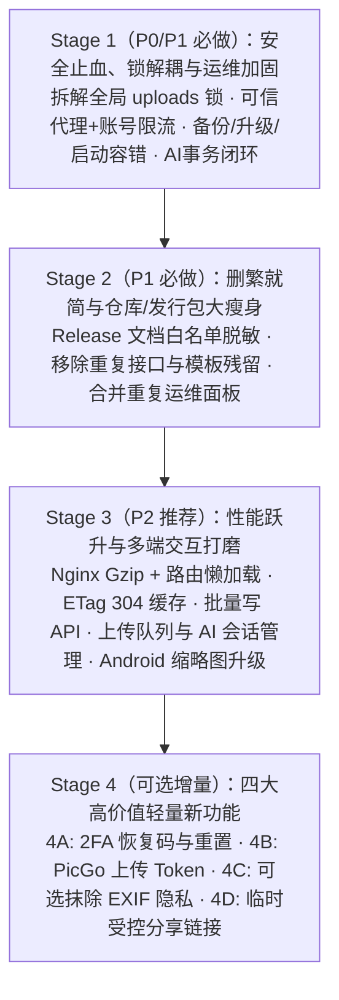

# 03 · 分阶段演进计划与优先级排期

为确保每次变更范围可控、可独立编译、可隔离测试且零生产事故，我们将全部改进项按 **“先止血加固 → 再精简瘦身 → 后提速增效 → 按需上新功能”** 的工程顺序拆分为 **4 个大阶段（Stage 1 ~ Stage 4）**。

---

## 一、总体演进路线图

---

## 二、各阶段目标、收益与边界表

| 阶段 | 优先级 | 核心交付内容 | 是否涉及 DB 迁移 | 预期量化收益与解决的风险 |
|---|---|---|---|---|
| **Stage 1：安全止血与运维加固** | **P0 / P1** | 1. 原图/缩略图脱离 `state.uploads`，网络读取与解码移出临界区，保留按用户对账锁 2. 容器反代透传真实 IP + 用户名失败限流 + 修复固定窗口过期不重置 3. `bootstrap` 单图/次盘异常降级告警不阻断主盘启动 4. `piccovectl backup` 停写后查外盘、纳入 `compose.override.yml`、确保异常后恢复服务 5. `piccovectl update` 先构建再停服，验收切换与旧镜像清理解耦，补齐自定义目录祖先权限校验 6. AI 落盘与消息完成同事务、消除 `let _ =` 静默吞错、失败哈希重传可重审、补齐 `disabled` 与 `deleted_at` 口径一致性 | **否（零表结构变更）** | 彻底消除单慢连接卡死全站外链、20 次坏请求锁死全站登录、次盘离线整站宕机、升级删旧镜像反杀新服务、备份漏掉 AI 路由配置五大高危隐患。 |
| **Stage 2：删繁就简与脱敏瘦身** | **P1** | 1. `scripts/release.py` 改为文档白名单打包，剔除 `DEPLOY-tu.jpggg.com.md` 等站点私有与历史草稿 2. 下线重复接口 `/api/v1/admin/storage` 并对齐 `api_smoke.py` 3. 合并前端 `overview-page` 与 `settings-page` 重复系统服务控制卡 4. 清理 `admin/nginx.conf`、`documentation.html`、`apps/web/`、`infra` 无用 Redis、18+ 个零引用 UI 组件与模板图标，替换图湾专属 Favicon，移除 `artifacts/ui-review` 跟踪文件并校准 `README`/`ANDROID` 文档 | **否** | 消除公开 Release 包暴露服务器部署拓扑问题；砍掉约 2,500+ 行无用代码/模板残留与 ~2 MiB 仓库冗余图片，统一单一事实源。 |
| **Stage 3：性能与多端体验升级** | **P2** | 1. `deploy/nginx.conf` 开启 `gzip` + `App.tsx` 路由级 `React.lazy` 分包 + 登录页协议自适应与已登录跳转 2. 原图/缩略图支持鉴权后 `ETag` + `304 Not Modified` 3. 新增 `POST /api/v1/images/batch` 批量移动/公开/删除接口，修复前端删除与审核预览错误处理、补齐 React Query `user.id` 键隔离与粘贴监听依赖 4. 上传队列批次隔离 +“清除已完成”+ 历史上限收敛 5. AI 会话支持重命名/归档删除、放宽无关历史图删除限制、消除审核 Worker 2 秒固定空等、复用全局 `reqwest::Client` 6. Android 端接入鉴权缩略图、规范分享后缀链接、一步相册上传与局部 `PATCH` | **1 个极小迁移**（`0010_ai_conversation_archive.sql`：为 `ai_conversations` 增加 `archived_at` 列） | 首屏 JS 传输体积下降 **75%+**；48 张批量操作从 48 次串行请求降为 **1 次**；批量导入审核吞吐提升数倍；Android 图库浏览流量下降 **90%+**。 |
| **Stage 4：高价值新功能落地** | **P2/P3（按需勾选）** | - **4A**：TOTP 8 组一次性恢复码 + 后台/CLI 重置二步验证 - **4B**：个人 API Token 管理 + `Bearer` 免 Cookie 上传 + PicGo 配置一键生成 - **4C**：上传可选剥离 JPEG/PNG/WebP EXIF/GPS 隐私元数据（保留断连源摘要对账） - **4D**：`/s/{token}` 可设到期时间、可随时撤销的单图临时分享链接 | **1 个组合迁移**（`0011_tokens_shares_recovery.sql`） | 补齐二步验证防锁死兜底、打通桌面写作工具一键传图生态、兼顾公开分享隐私保护与私图受控外发。 |

---

## 三、版本管理与回退安全策略

1. **版本号与构建标识清晰化**：
   - 在正式打包发布前使用 `bash piccove.sh version --set 0.2.0`（或 `0.1.15`）统一递增 Cargo 与 npm 四份清单版本；
   - `/api/v1/admin/system` 额外返回构建时的短 Git Commit（编译期或 `release.json` 读取），让管理后台一眼确认线上运行的确切提交。
2. **向后兼容与零停机演进边界**：
   - **Stage 1 ~ Stage 2 零数据库迁移**：随时可独立构建、验证、上线，不改变任何已有图片文件布局、外链 URL、密码哈希或 Passkey 凭证格式。
   - **Stage 3 ~ Stage 4 增量非破坏性迁移**：仅新增可空列（`archived_at`、`source_hash`、`totp_recovery_hashes`）与独立新表（`api_tokens`、`image_shares`），不对百万级存量数据做锁表重写；旧版 Android 客户端即使暂未升级仍可正常登录、浏览和上传。
