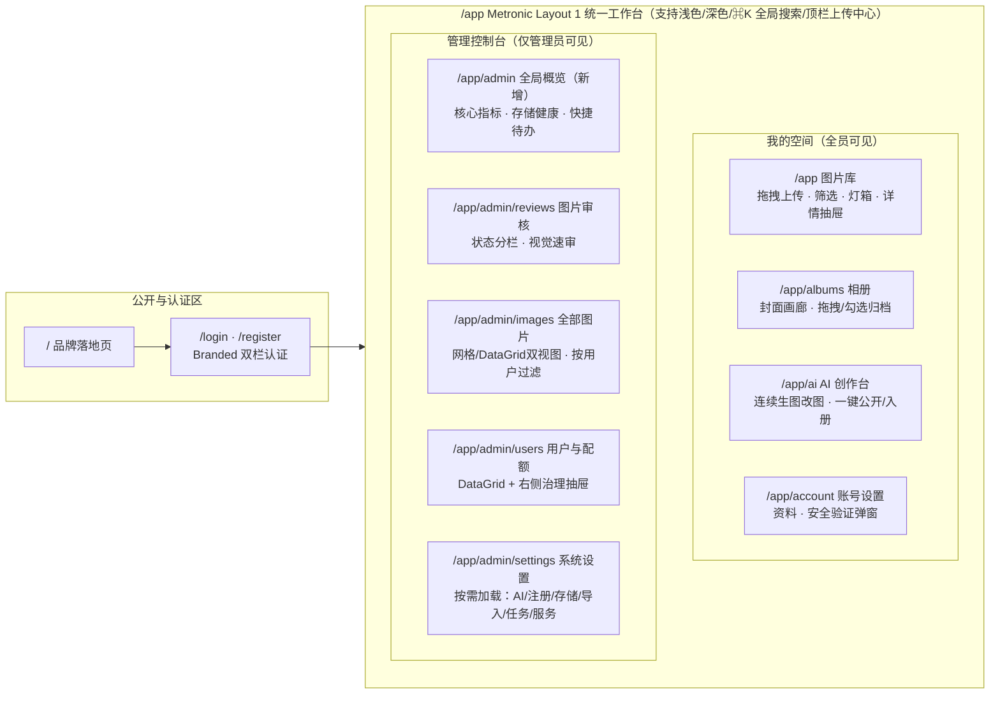

# 03 · 产品交互重设计与文案“去注释化”规范

本文档定义推翻重做后的**信息架构（IA）、核心交互流、各页面重设计规格**，以及严格执行的**前端文案“去注释化”准则**。设计目标只有一句话：**让用户与管理员一眼看懂、一步直达，不需要阅读任何一段“说明书式解释”。**

---

## 一、全新信息架构与全局交互升级

### 四项全局级人性化体验革新

1. **全局快捷键与命令面板（`⌘K` / `Ctrl+K`）**
   - 基于仓内已安装的 `cmdk`（Metronic `CommandDialog`），随时按下 `⌘K` 即可快速跳转页面、搜索自己的相册、切换深浅色主题、管理员快速跳到指定系统设置项或发起“上传图片”。
2. **非侵入式“顶栏上传中心（Upload Center）”**
   - 彻底取消原先横亘在页面中间、把图库挤到屏幕下方的硕大上传队列块。
   - 上传开始时，Header 右上角浮现精致的动态环形/条形进度胶囊（显示 `上传中 3/12`），点击展开 `Popover` / 右侧 `Sheet` 明细抽屉：支持暂停、重试失败项、一键“复制本次全部外链”，切换任意工作台页面均不中断且不遮挡视线。
   - 文件大小（`> 10 MiB`）与格式校验前置到文件入队瞬间拦截，绝不先把超大垃圾文件塞进 IndexedDB。
3. **沉浸式大图灯箱（Lightbox）+ 右侧详情抽屉（Inspector Sheet）**
   - 点击图片缩略图不再傻傻 `target="_blank"` 跳走，而是打开全屏高清灯箱（支持键盘 `←` `→` 翻看上一张/下一张、滚轮缩放、底部快捷复制直链/Markdown）。
   - 点击卡片信息或“详情”打开右侧 `Sheet` 抽屉：集中展示预览图、文件名（可直接内联改名保存）、所属相册下拉切换、**公开/私有实时 Switch 开关**、审核状态徽章、分辨率/体积/MIME/上传时间，以及 6 种外链格式一键复制按钮组。
4. **底部悬浮多选动作栏（Floating Batch Bar）**
   - 未选图时隐藏冗余批量按钮，保持工具栏极致清爽；勾选任意图片（支持按住 `Shift` 连选！）后，屏幕底部居中优雅浮出毛玻璃操作岛：`已选 N 张` | `复制外链` | `设为公开/私有` | `移入相册` | `删除` | `取消`。

---

## 二、核心页面重设计蓝图

### 1. 认证页（`/login`、`/register`）
- 采用 Metronic `BrandedLayout`：左侧纯净表单卡片，右侧展示图湾品牌视觉与特性微卡。
- 登录方式用分段切换器（Segmented Tabs）直观呈现 `Passkey 通行密钥` 与 `密码登录`（不再用一个突兀的次级按钮来回变文字）。
- **修复密码自锁缺陷**：登录框移除错误的 `minLength={12}` 字符限制；注册与改密统一采用实时友好的字节/长度提示，以服务端规则为单一事实源。

### 2. 个人图片库（`/app`）与相册（`/app/albums`）
- **紧凑型智能上传条**：默认是一条高颜值紧凑虚线拖放横幅（而非占半屏的大框），拖入文件或粘贴剪贴板图片时高亮放大；内置**“目标相册”选择器**与**“默认公开 / 私密保存”切换胶囊**（直接打通后端 `?private=true`！）。
- **真·多维工具栏**：`文件名搜索框` + `相册筛选` + `可见性筛选（全部/公开/私有）` + `紧凑网格 / 宽松卡片 / 列表视图切换`。
- **克制的图片卡片**：顶部高清等比/自适应裁剪缩略图（右上角仅在“私有”或“审核异常”时贴一枚精巧半透明徽章，正常公开通过的图片**零多余文字标签**！）；底部仅一行文件名 + 悬停秒点“复制直链”图标按钮与 `⋯` 菜单（含右键 `ContextMenu` 支持！）。

### 3. AI 图片创作台（`/app/ai`）
- 左侧可折叠会话列表，中间清爽对话流，底部现代悬浮输入框（带参考图缩略图徽章与进度条，自动携带 `expected_user_id`；若命中已公开图片去重，以温和 Badge 提示“已关联图库原图”）。
- **打通创作到分享最后一公里**：AI 生成出来的每张图片下方直接提供三个快捷轻按钮：**`复制外链`（若当前为私有，弹窗一键确认“设为公开并复制链接”）**、**`归入相册`**、**`以此图继续修改`**——彻底终结“去安卓端设为公开”的荒诞断点！
- **按需智能轮询**：仅当当前会话存在 `queued / running` 生成任务或图片处于 `pending / running` 审核中时开启轮询，任务结束后自动静默停止轮询，历史消息优先加载缩略图，点击看大图灯箱。

### 4. 管理员控制台（四大中心全面升级）

#### (1) 全局概览 Dashboard（`/app/admin`，新增）
- **顶部 4 张 Metronic KPI 统计卡**：
  1. **注册用户数**（正常 / 已禁用，附“创建用户”快捷入口）
  2. **托管图片总量**（有效图片数，附“全部图片”入口）
  3. **总存储占用 & 默认盘可用空间**（直观容量进度条，低于阈值高亮告警）
  4. **待人工复核图片数**（`review` 状态计数，大于 0 时琥珀色高亮一键直达审核台）
- **下部双栏状态卡**：左侧“存储挂载点健康概览”，右侧“服务版本与宿主机管理服务状态”（检查更新 / 重启服务，使用 `AlertDialog` 二次确认）+ 最近后台文件任务进度。

#### (2) 图片审核中心（`/app/admin/reviews`）
- 顶部状态分段 Tab：`待人工复核`（默认聚焦最需要管理员处理的项！）| `已拦截` | `审核失败` | `全部记录`，附各状态实时计数徽章。
- 审核卡片采用清晰的左右结构：左侧高清缩略图（点击灯箱看原图细节），右侧结构化展示上传者徽章、触发类别 Tags、AI 判定原因，右侧对齐三枚干净动作按钮：`通过（撤销误判）`、`确认违规`、`重试`。

#### (3) 全部图片治理（`/app/admin/images`）
- 默认提供 **Metronic `DataGrid` 管理表格视图** 与 **视觉网格视图** 一键切换！
- 表格列：`缩略图` | `文件名与尺寸/大小` | `所属用户（真实用户名徽章，点击即按该用户过滤！）` | `可见性` | `审核状态` | `上传时间` | `操作（预览 / 详情 / 删除）`。
- 顶部筛选栏支持按 `文件名搜索`、`指定用户`、`可见性`、`审核状态` 组合过滤。

#### (4) 用户与配额管理（`/app/admin/users`）
- 标准 Metronic `DataGrid`：`用户（头像首字母 + 用户名 + 管理员标识）` | `账号状态徽章` | `内容审核状态（正常 / 白名单徽章 / 封禁徽章 + 违规次数）` | `存储配额使用率（可视化 Progress 条 + 已用/总额）` | `操作（管理按钮）`。
- **移除表格行内裸塞的复选框与封禁大按钮**：点击某行的“管理”打开右侧 **`UserDetailSheet` 抽屉**，在一个干净的分段面板内完成：调整配额（支持输入 GiB / MiB 快捷预设按钮如 `512 MiB`、`1 GiB`、`5 GiB`、`10 GiB`）、重置密码、审核白名单 Switch、内容封禁/解封、禁用账号，以及一键跳转查看“该用户的全部图片”。

### 5. 账号设置（`/app/account`）与系统设置（`/app/admin/settings`）
- **账号安全重做（告别顶置密码框）**：采用 Metronic `Account > Security` 标准行式卡片——“登录用户名”、“登录密码”、“二步验证（TOTP）”、“Passkey 通行密钥”各自独立成行展示当前状态徽章；点击任一行的“修改 / 绑定 / 移除”时，才在弹出的专属 `Dialog` 内要求输入当前密码（及 TOTP 验证码），符合全球主流产品直觉。
- **系统设置真按需加载**：左侧垂直分类导航切换时，**仅渲染并激活当前选中分类的组件与请求**（彻底消灭后台隐藏轮询！）；批量导入的用户选择升级为可搜索下拉选择器（`Popover` + `Command` 搜索 `/admin/users?q=...`），再也不用痛苦地翻页找用户，且提交导入后直接展开该任务的实时进度面板。

---

## 三、前端文案“去注释化”铁律与新旧对照表

### 三条文案铁律（实施强制门禁）
1. **不写后端实现原理**：凡涉及 HTTP 接口名、Base64、SHA-256 哈希、数据库事务、IndexedDB、锁机制的句子，**100% 禁止出现在页面常驻文本中**。
2. **不重复常识性默认行为**：“改名不改外链”、“移动相册不改外链”、“改用户名不影响已有图片”属于产品基本功，**全部删掉**，只在“删除图片导致外链永久失效”这种不可逆破坏动作的 `AlertDialog` 中做精炼提示。
3. **复杂规则收进 `?` Tooltip 或按需折叠**：仅管理员配置项（如 API Base URL 格式）需要补充说明时，用 15 字以内的简短 `placeholder` 或标题旁的小问号 `Tooltip` 承载，绝不铺满表单。

### 典型奇葩文案清洗对照表（节选 12 处代表项）

| 场景 | 旧版“工程师注释腔”文案 | 重构后处理方式 / 新文案 |
|---|---|---|
| 侧边栏底部存储卡 | *“网页上传的图片默认公开；私有图片仅本人和管理员可见。”* | **直接删除**（上传栏本身已有清晰的“公开 / 私有”状态胶囊） |
| 上传框底部两行小字 | *“上传的图片可通过链接访问，管理员也可以查看和删除。”* | **直接删除**，仅保留一行极简格式说明：`支持 JPG / PNG / WebP / GIF，单张最大 10 MiB` |
| 上传队列顶部 | *“可以切换工作台页面；离开会暂停上传。待传文件保存在本浏览器，返回同一账号后可恢复。”* | **直接删除**（顶栏上传中心本身就用行动证明了切页不中断；仅在有未完成恢复项时显示简洁提示条 `检测到 N 张未完成上传 · [继续上传]`） |
| 复制私有图提示 | *“这是私有图片，如需公开分享，请先在安卓端设为公开”* | 改为可执行交互：**`当前为私有图片，设为公开后即可分享外链` + `[设为公开并复制]` 按钮** |
| 批量复制跳过提示 | *“已跳过 X 张不可分享图片（私有、待清理或审核限制），公开状态保持不变。”* | 精简为温和 Alert：**`已跳过 X 张私有或受限图片`** |
| 移动/编辑图片与相册（6处） | *“每张图片只属于一个相册。移动会离开原相册，图片和外链保持不变。”* | **全部删除冗余解释**，弹窗仅保留清爽标题 `移动到相册` 与目标选择器 |
| 删除图片确认框 | *“删除后无法恢复，之前复制或分享的链接也会失效。重复上传得到的同一图片链接同样会失效；文件清理完成后，所占空间会释放。”* | 精简为直白人话：**`永久删除后无法恢复，已分享的外链将立即失效。`** |
| AI 生图设置说明 | *“仅需图片模型；连续修改使用图片编辑接口。上游需支持 Base64 图片输出。模型列表不代表能力检测，请选择支持对应功能的模型。”* | **删除协议细节**，模式选项自身副标题写清：`独立生图模型（推荐）` / `Responses 对话工具模式` |
| AI 审核设置说明 | *“色情、暴力、血腥、中国政治人物敏感均计次，AI 生成结果也计次。疑似结果限制访问但不计次。管理员默认免审。”* | 精简为表单项辅助短句：**`明确违规自动拦截并计次，疑似内容转入人工复核。`** |
| 图片审核页副标题 | *“自动审核为主。撤销误判会扣回对应次数；手动封禁不会随之解除。”* | 改为清晰职责说明：**`复核疑似违规图片，处理申诉与误判。`** |
| 账号安全页顶部 | *“修改验证方式前，请输入当前密码；开启二步验证后还需验证码。修改密码请使用下方表单。”* | **连同顶置表单一起废除**，改为点击具体操作时弹出 `身份验证` 弹窗 |
| 批量导入页说明 | *“上传时请使用 .part 临时后缀，传输完成后改回图片扩展名。同一用户已导入过的相同路径、相同内容图片会自动跳过。”* | 收纳进右上角 `导入说明` 悬浮 Popover，主界面保持清爽三步向导 |
