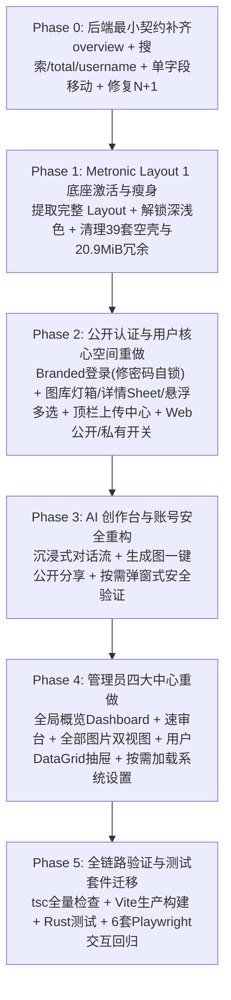

# 04 · 分阶段实施计划、测试迁移与 AGY×Codex 协作监督规范

> **执行前提**：本文档为实施施工图。在您审阅并确认前，我们不会改动任何业务源码；确认后严格按以下阶段推进，每阶段保持可编译、可测试、可回退。

---

## 一、分阶段实施路线图（6 个里程碑）

### Phase 0：后端最小高价值 API 补齐（`apps/api`）
- **范围**：
  1. `apps/api/src/main.rs`：新增 `GET /api/v1/admin/overview`；扩展 `GET /api/v1/images` 支持 `q`、`is_public`、`moderation_status`、`user_id` 并返回 `total`、管理员 `username` 及图片 `created_at` / `content_type`；扩展 `GET /api/v1/admin/users` 支持 `q` / `status`、返回 `total` 并将 48 次循环求和合并为单条聚合 SQL；扩展 `PATCH /api/v1/images/{id}` 支持仅传 `album_id` 或仅传 `original_name`。
  2. `apps/api/src/ai.rs`：扩展 `GET /api/v1/admin/reviews` 支持 `status` 筛选并返回 `total`。
- **不变性红线**：不新增数据库表迁移、不破坏现有请求格式、204 状态码与权限边界，确保 Android 客户端与 `tests/api_smoke.py` 原样通过。
- **阶段验收**：`cargo fmt --check`、`cargo test --locked`、隔离数据库 HTTP 接口验证。

### Phase 1：Metronic v9.5.0 底座激活、类型恢复与包体大瘦身（`admin`）
- **范围**：
  1. 从本地模板压缩包提取 `Layout 1` 核心结构并完成 React Router v7 纯净化改造，落地 `admin/src/components/layout/`（含可折叠 Sidebar、吸顶 Header、移动端导航 `Sheet`、`⌘K` 全局命令面板骨架、Light/Dark/System 主题切换、顶栏 `UserDropdownMenu`）。
  2. 清理 `admin/src/components/layouts/layout-1..39`、`admin/src/pages/layout-1..39`、`admin/src/config/layout-*.config.tsx`、`admin/public/media/*`（释放 ~20.9 MiB）及 `package.json` 中的无用重型依赖（地图/图表/重复通知库等）。
  3. 恢复 `admin/tsconfig.app.json` 为 `"include": ["src"]`，修复全仓严格类型检查。
- **阶段验收**：`npm run build`（含全量 `tsc`）零报错通过，验证桌面端侧栏 280px↔80px 折叠、移动端抽屉导航及深浅色切换流畅无溢出。

### Phase 2：认证页、个人图库、相册与顶栏上传中心重做
- **范围**：
  1. 落地 `features/auth/`：升级轻量品牌首页与 `BrandedLayout` 登录/注册页，修复多字节密码 `minLength` 冲突。
  2. 落地 `features/uploads/`：升级 IndexedDB 上传队列（前置 10 MiB 校验、持久化上传公开/私有选项、保留精确后端错误码）与 Header 右上角非侵入式 `UploadCenter` 浮窗/抽屉。
  3. 落地 `features/gallery/` 与 `features/albums/`：紧凑拖拽粘贴上传栏（支持选相册 + 选公开/私有）、多维筛选工具栏、克制高颜值图片卡片（右键菜单 + 悬停复制）、全屏大图灯箱 `LightboxDialog`、右侧详情 `Sheet`（内联改名、切相册、公开/私有 `Switch`、6 种外链复制、二维码）、底部悬浮批量操作栏。

### Phase 3：AI 创作台与个人账号安全重做
- **范围**：
  1. 落地 `features/ai/`：双栏响应式创作台，参考图补齐 `expected_user_id` 与公开图复用提示，生成结果卡片直接支持“设为公开并复制外链 / 存入相册 / 继续改图”，优化轮询仅在进行中任务激活，历史消息优先走缩略图。
  2. 落地 `features/account/`：个人资料与安全设置行式卡片，将改用户名、改密码、绑定/关闭 TOTP、添加/删除 Passkey 全部改为独立行触发专属验证 `Dialog` / `AlertDialog`。

### Phase 4：管理员四大中心全面重做 & 退役 `style.css`
- **范围**：
  1. 落地 `features/admin/overview-page.tsx`（`/app/admin`）：4 张 KPI 指标卡 + 存储挂载健康卡 + 服务版本更新/重启运维卡。
  2. 落地 `features/admin/reviews-page.tsx`：状态分段 Tab（默认聚焦“待人工复核”）+ 高效视觉裁决卡。
  3. 落地 `features/admin/all-images-page.tsx`：Metronic `DataGrid` 表格 / 网格双视图 + 真实用户名徽章（点击即按用户筛选）+ 组合过滤器。
  4. 落地 `features/admin/users-page.tsx`：用户 `DataGrid`（可视化配额条 + 状态徽章）+ 右侧 `UserDetailSheet` 治理抽屉（配额快捷预设 + 重置密码 + 白名单 + 封禁）。
  5. 落地 `features/admin/settings-page.tsx`：真按需挂载分类面板（彻底消除后台隐藏轮询），移除 AI 表单冗余前端 `setCustomValidity` 校验与工程注释文案，批量导入升级为可搜索用户选择器并联动任务进度详情。
  6. **彻底删除 `admin/src/piccove/style.css` 与旧 `admin/src/piccove/` 遗留文件**。

### Phase 5：构建门禁、Playwright 测试迁移与全链路验收
- **范围**：对齐发版脚本健康检查与全部自动化测试，确保零回归交付。

---

## 二、构建门禁与测试套件迁移策略

经交叉核查，项目共有两层测试体系，重构时必须精准对齐：

| 测试文件 | 是否为 `release.py` 硬门禁 | 受重构影响点与迁移方案 |
|---|---|---|
| `apps/api` Rust 单测 + `tests/api_smoke.py` | **是（发版硬门禁）** | 保持 100% 原样通过，并补充新查询参数、`overview` 与单字段移动相册断言。 |
| `piccovectl health`（`ctl/mod.rs:575`） | **是（部署健康门禁）** | 要求 `index.html` 标题/正文含 `PicCove` 字符串且静态 `/assets/` 可逐字节校验——重构 `index.html` 时严守该契约。 |
| `tests/web.test.mts` | **是（发版硬门禁）** | 将模块导入路径更新至 `admin/src/lib/api.ts` 与 `passkey.ts`，保留全部 6 种外链转义、分享矩阵、48 分批核对与 WebAuthn 编解码断言。 |
| `tests/upload.test.mjs` | **是（发版硬门禁）** | 更新导入路径至新 `upload.ts`，原样保留进度、100% 传输后等待落盘、去重、429 限流与超时中止断言。 |
| `tests/settings-layout.test.mjs` 等 6 个 Chromium 交互用例 | 本地/离线 UI 回归套件 | 废除对 `.cove-*` 类名、原生 `window.confirm` 及旧工程注释全文的死板绑定；统一迁移为基于**无障碍语义角色（`getByRole` / `getByLabel`）**定位 Metronic `Layout 1` 折叠侧栏、`Sheet`、`AlertDialog`、`DataGrid` 与新交互流程，并新增“隐藏设置页零后台轮询”、“Web 端切换公开/私有”、“多字节密码改密后成功重登”断言。 |

---

## 三、AGY × Codex 互补分工与“反过度防御”监督机制

在后续代码实施阶段，将由 **Antigravity (AGY) 担任总架构师、UI/UX 审美把关人与终审官**，结合 **Codex 处理高密度后端 SQL/API 扩展与测试迁移**，并严格执行以下监督铁律：

### 1. 分工互补模式
- **AGY 主导负责**：Metronic Layout 1 外壳提取与视觉精调、Tailwind v4 主题令牌、全部前端页面的布局/审美/微交互与人性化精简文案、最终逐文件代码审查与清理验收。
- **Codex 协同负责**：Phase 0 Rust API 最小扩展与单元测试、上传队列/恢复边界状态核对、Phase 5 离线测试夹具更新，以及对 AGY 前端改动的独立静态复核（排查遗漏权限边界或竞态问题）。

### 2. AGY 监督 Codex 的“六条反过度防御红线”
每次向 Codex 下发子任务及合并其改动前，AGY 必逐行检查 `git diff`，触犯以下任一红线立即剔除或打回：
1. **严禁再往前端 JSX 塞工程注释式解释**：任何超过一行的机制说明、协议科普、重复免责声明一律删干净。
2. **严禁手写与后端冲突的前端重复校验器**：不再编写 `setCustomValidity` 循环状态机或脆弱的 `pattern` 正则；表单只做基础必填与格式引导，以服务端 `ApiError` 为单一事实源（且同一错误只展示一次，禁止 Toast + 页内红字双倍轰炸）。
3. **严禁静默吞错与猜测性兜底**：禁止出现无根据的 `catch {}` 吞错、禁止把“接口网络超时/查询失败”静默伪造为 `deleted_at = 当前时间`。
4. **严禁新增无人要求的抽象层与预留配置**：不封装多余的 Adapter / Factory / Wrapper，直接复用仓内 `api()`、TanStack Query 与 `src/components/ui/*` 现成 ReUI 组件。
5. **严禁手写平行 CSS 覆盖设计系统**：除极个别动画或滚动条微调外，一律使用 Tailwind v4 工具类与 Metronic 标准变量，禁止新建第二个 `style.css`。
6. **强制清理与独立验收**：每阶段完成后清理 `/tmp`、`.pyc`、`target` 等临时产物，由 AGY 亲自跑通 `tsc`、`vite build`、`cargo test` 与核心交互检查后再交付。
